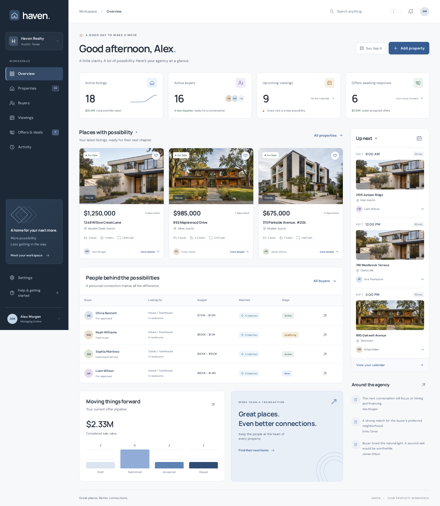
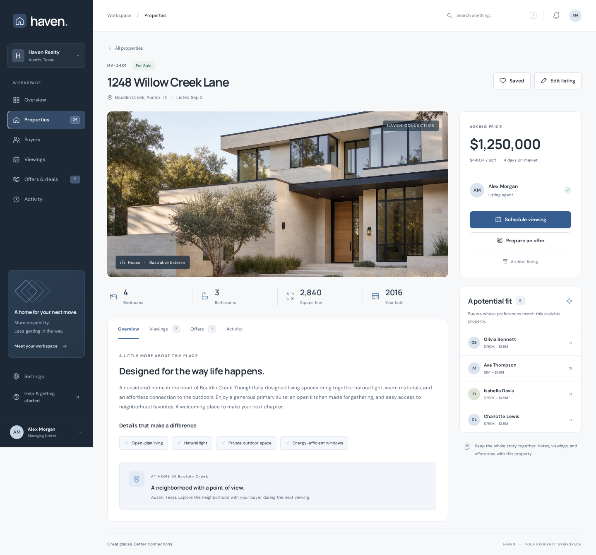
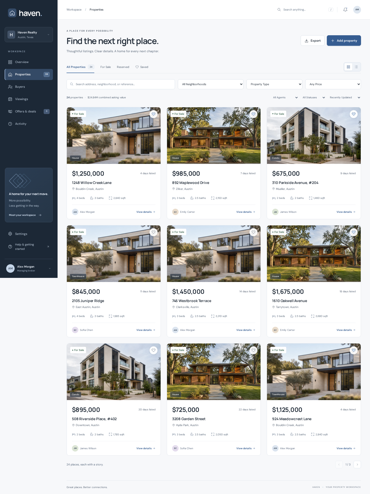
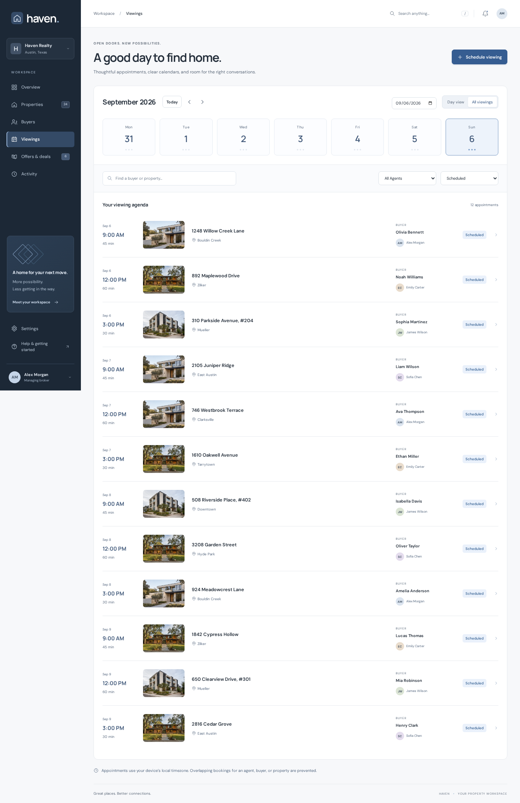
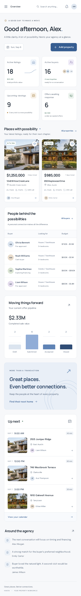

<div align="center">

# ⌂ Angular CRM Property Desk

**Haven — a considered real estate workspace for connecting properties, buyers, viewings, and the next chapter.**


[](https://vercel.com/new)

</div>

---



## ✨ Highlights

- **A distinct visual identity:** Graphite navigation, soft slate accents, generous property photography, self-hosted DM Sans and Manrope, and original SVG icons.
- **A connected agency overview:** Available inventory, open buyer relationships, future appointments, offer counts, asking portfolio value, and completed sale value reflect the current workspace.
- **A searchable property collection:** Address, neighborhood, reference, description, price range, type, agent, status, and agency favorites; URL-backed filters, sorting, pagination, and grid/table views.
- **Property workspaces:** Listing details, features, asking price, agent ownership, matching buyers, related viewings, offers, notes, and a preserved activity trail.
- **Buyer relationships:** Contact details, financing context, budget range, bedrooms, property types, neighborhoods, lifecycle stages, and a separate personal shortlist.
- **Useful matching:** Available properties must meet all buyer preferences. Closed buyers have no active matches; shortlisted properties retain their changing availability.
- **A calendar that protects people’s time:** Date selection, week navigation, all-appointment agenda, search, agent/status filters, overlap rejection, rescheduling, cancellation, and post-visit feedback.
- **An offer-to-sale workflow:** Precise draft amounts, submission records, seller decisions, property reservations, withdrawal reasons, three closing conditions, and an explicit sale confirmation.
- **Atomic deal changes:** Accepting reserves the property and cancels other buyers’ scheduled visits. Closing marks it sold, cancels remaining appointments, and withdraws competing open offers.
- **Durable local work:** Zod-validated snapshots, serialized writes, dedicated IndexedDB persistence, recoverable failures, session fallback, and a confirmed demo reset.
- **CSV export:** Every matching property, across every page, with quoted fields, exact dollar amounts, and spreadsheet formula-prefix handling.
- **Accessible interactions:** Named CDK dialogs, focus restoration, visible keyboard focus, a skip link, reduced-motion support, inline errors, and live status announcements.

## 🖼️ A Closer Look



<details>
<summary>Explore the property collection, viewing calendar, and mobile overview</summary>







</details>

Screenshots show the actual application. Listing photographs are original AI-generated architectural concepts. Three images are deliberately reused across the fictional property records. See [asset provenance and generation prompts](./docs/assets.md).

## 🧱 Project Structure

```text
public/
  favicon.svg
  images/                         # Three original WebP property images
  sample-workspace.json            # Complete, related fictional agency
src/
  app/
    app.ts                        # Navigation, search, focus, and shell
    app.html
    app.config.ts                 # Router and HttpClient configuration
    app.routes.ts                 # Lazy feature routes and document titles
    core/
      domain.ts                   # Zod schemas, relationships, money, matching
      workspace-store.ts          # Shared Signals and HttpClient operations
    mocks/
      mock-api.interceptor.ts     # /api interception, latency, one-shot failures
      mock-database.ts            # Validated transactions and IndexedDB
      mock-options.ts
    features/
      overview/
      properties/
      buyers/
      viewings/
      offers/
      activity/
      settings/
    shared/                       # Icons, property cards, dialogs, notes, history
  index.html
  styles.css
  main.ts
scripts/preview.mjs                # Production SPA preview with deep links
tests/workspace.spec.ts           # Browser workflows against a production build
docs/assets.md                    # Image prompts, files, and provenance
docs/licenses/                    # Full font license notices
docs/screenshots/
playwright.config.ts
vercel.json
LICENSE
```

## 🛠️ Tech Stack

- Angular 21, standalone components, strict templates, zoneless change detection, and lazy routing
- TypeScript 5.9, Angular Signals, RxJS, reactive forms, and template forms
- Angular CDK dialogs, overlays, focus management, and live announcements
- Zod 4 for input, fixture, snapshot, and relationship validation
- IndexedDB through `idb-keyval`, with in-memory fallback
- CSS, locally bundled variable fonts, and inline SVG icons
- Playwright for Chromium browser scenarios; Prettier for formatting

## 📦 Included Demo Data

| Record           | Count | Contents                                                         |
| ---------------- | ----: | ---------------------------------------------------------------- |
| Properties       |    24 | 18 available, 2 reserved, 2 sold, 2 archived                     |
| Buyers           |    18 | Preferences, contact context, financing, and personal shortlists |
| Agents           |     4 | Ownership, showing assignments, and agency profiles              |
| Viewings         |    26 | 12 scheduled, 10 completed, 4 cancelled                          |
| Offers           |    14 | Draft, submitted, accepted, closed, declined, and withdrawn      |
| Activity entries |   102 | Connected listing, buyer, appointment, offer, and note history   |

All identities, addresses, contacts, prices, appointments, and transactions are synthetic. Email addresses use the `.example` domain. No real listings, calendar invitations, offers, contracts, signatures, or payments are connected.

On first load and reset, dates move relative to the fixture’s anchor day. Existing saved work keeps its original dates on subsequent visits. Appointment times display in the device’s local timezone; listing and closing dates are calendar dates. USD values use integer cents internally. The listing sparkline counts records listed by each weekly checkpoint; offer bars show current status counts.

## 🚀 Local Development

Use Node.js `^20.19.0`, `^22.12.0`, or `>=24.0.0`. Dependencies are installed locally.

```bash
npm ci
npm run dev
```

Open `http://localhost:4400`. `npm start` runs the Angular development server on the same port without the explicit external bind.

This project started from a clean official Angular CLI scaffold:

```bash
npx --yes @angular/cli@21.2.23 new angular-crm-property-desk \
  --directory angular-crm-property-desk \
  --routing --style css --standalone --strict \
  --skip-git --skip-tests --skip-install --ssr false \
  --package-manager npm --defaults
```

The CLI-generated configuration and application entry points were retained and adapted. Application code, styles, data, and browser tests were added after scaffolding; the workspace was not copied from another CRM.

## 🧭 Try a Connected Workflow

1. Open **Buyers → Olivia Bennett** and explore matching homes. Add a property to her personal shortlist or edit her budget to refresh matches.
2. Open **1248 Willow Creek Lane** and schedule a future viewing. Try an overlapping appointment for the same agent, buyer, or property to see the conflict message.
3. Open **Offers & deals** and find Olivia’s submitted offer for that property. **Accept & reserve** connects the reservation and the related appointment changes.
4. Try **Record sale** before completing the conditions. Verify buyer funds, inspection, and the signed agreement, then confirm the sale.
5. Revisit the property and buyer: availability, linked offers, viewings, and activity now reflect the decision.
6. In **Settings**, select a response delay or fail the next request. A failed write preserves saved data; retry the action. Reset the demo with the explicit confirmation to begin again.

Agency **Saved** properties and an individual buyer’s **Shortlist** are separate collections.

## 🔌 Mock API & Extension Notes

Angular `HttpClient` calls `/api/*`. The interceptor simulates responses in the browser; there is **no running HTTP backend**. Direct `fetch`, curl, and another application will not reach these mock endpoints. The fixture itself is a regular static JSON request.

| Method       | Path                                     | Behavior                                                                          |
| ------------ | ---------------------------------------- | --------------------------------------------------------------------------------- |
| GET          | `/api/workspace`                         | Load the validated connected snapshot                                             |
| GET          | `/api/properties`                        | Filter, search, sort, and page properties; return matching count and asking value |
| POST / PATCH | `/api/properties`, `/api/properties/:id` | Create, edit, save, archive, or relist                                            |
| POST / PATCH | `/api/buyers`, `/api/buyers/:id`         | Create contacts and update preferences                                            |
| POST         | `/api/buyers/:id/shortlist`              | Toggle a property in the buyer’s shortlist                                        |
| POST / PATCH | `/api/viewings`, `/api/viewings/:id`     | Book, reschedule, cancel, or record feedback                                      |
| POST / PATCH | `/api/offers`, `/api/offers/:id`         | Draft, edit, transition, or update closing conditions                             |
| POST         | `/api/notes`                             | Add history attached to a property or buyer                                       |
| POST         | `/api/reset`                             | Replace saved demo state with a fresh, rebased fixture                            |

Successful writes return `{ workspace, id }`. Property queries return `{ items, total, valueCents, page, pages }`. Error responses carry `{ message }`, using validation, conflict, missing-record, and simulated-unavailable statuses. The listing query accepts `search`, `district`, `type`, `status`, `agent`, `price`, `sort`, `featured`, `page`, and `pageSize`; page sizes are capped at 100.

The mock intentionally keeps domain rules out of templates:

- Duplicate listing addresses, buyer emails, invalid money precision, reversed budgets, missing relationships, and inconsistent sale/reservation states are rejected.
- New viewings require available inventory, an open buyer, a future start, and no overlapping scheduled viewing for any shared agent, buyer, or property. Back-to-back appointments are allowed. An existing visit for the accepted buyer may also be rescheduled while their property is reserved.
- Feedback requires the scheduled start to have passed. Both completed and cancelled viewings retain a reason; they cannot be rescheduled after an outcome.
- Offers follow `draft → submitted → accepted → closed`. Drafts may be withdrawn; submitted offers may be declined or withdrawn; accepted offers may be withdrawn to release the property. Repeated acceptance or closing of the same completed transition does not duplicate work.
- Only drafts can be edited. Only accepted offers expose editable closing conditions. A competing offer cannot reserve an already reserved or sold property.
- Accepting cancels other buyers’ scheduled viewings. Withdrawing releases availability without reviving cancelled appointments. Closing cancels all remaining scheduled viewings and withdraws competing draft/submitted offers.
- Available listings can be archived after open offers and scheduled visits are resolved. Reserved and sold inventory cannot be archived; sold listing details stay with the completed transaction.

The database is `haven-property-desk`, object store `workspace`, key `data`. Mutations validate a cloned snapshot before committing and run through one local queue. IndexedDB failure switches to session state with a visible notice. Incompatible persisted data is replaced with the original workspace.

To grow this into a larger application:

1. Replace the interceptor with a versioned backend while preserving feature components and typed domain boundaries. Move filtering, matching, pagination, and aggregate calculations to server queries as the dataset grows.
2. Enforce offer acceptance, unique reservations, appointment conflicts, closing conditions, and related cancellations in database transactions. Add idempotency keys and version checks; the local queue does not coordinate tabs, devices, or other users.
3. Add authenticated agency membership, role-based permissions, verified actors, and a server-owned audit trail. Current agents and the Alex Morgan profile are fictional assignments, not authentication.
4. Introduce real property media storage, distinct property addresses and geocoding, map search, richer buyer matching, and import validation.
5. Add explicit integrations for calendar invitations, communications, document storage, signatures, and listing feeds, with permissions and delivery status appropriate to each action.

This demo stores one workspace per browser origin. It has no cross-tab synchronization, backups, multi-agency isolation, or server authorization. Keep meaningful personal data out of a demo workspace.

## 🧪 Build & Checks

```bash
npm run format:check
npm run build
npx playwright install chromium
npm run test:e2e
npm audit --omit=dev
npm run preview
```

The 12 browser scenarios exercise listing/buyer validation, exact cents, preferences and matching, persistent shortlists, calendar overlaps, outcomes and rescheduling, competing offers, closing conditions, reservations, withdrawal, notes, CSV export, failure/retry, reset, storage recovery, keyboard focus, and viewport layouts at 320, 390, 768, and 1024 pixels.

Tests serve the production build on port **4401**. Run the build before tests. The standalone preview defaults to **4400** and supports direct links such as `/properties/property-001`.

Automated accessibility inspection covers feature pages and dialogs in Chromium. This complements the workflow and visual checks; it is not a substitute for testing with assistive technology and additional browsers before production use.

## 🌐 Vercel Deployment

```json
{
  "$schema": "https://openapi.vercel.sh/vercel.json",
  "framework": "angular",
  "buildCommand": "npm run build",
  "outputDirectory": "dist/angular-crm-property-desk/browser",
  "rewrites": [
    {
      "source": "/(.*)",
      "destination": "/index.html"
    }
  ]
}
```

The rewrite serves Angular routes on direct navigation. With this configuration, the CRM remains a browser-local mock application after deployment. Replace or narrow the catch-all when adding real API routes.

## 📄 License

MIT License. See the complete [LICENSE](./LICENSE).

DM Sans and Manrope are bundled with their full [font license notices](./docs/licenses/). See [assets and provenance](./docs/assets.md) for property image generation details.
